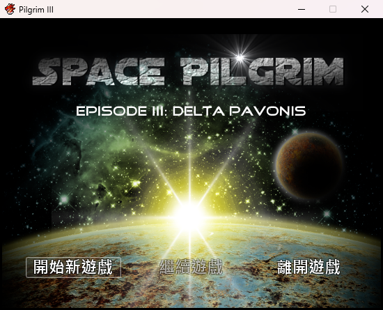

# Space Pilgrim Episode III Delta Pavonis 繁體中文化

[繁中翻譯工作表](Space%20Pilgrim%20Episode%20III%20-%20繁中翻譯工作表.xlsx)以 Steam 安裝版的原始資料為底稿。逐條在「繁體中文」欄填寫譯文，保留原文、編號、來源位置、換行和控制碼。

| 工作表 | 筆數 | 內容 |
| --- | ---: | --- |
| 劇情事件 | 8,731 | 對話、選項、選項分支標籤及捲動文字 |
| 資料庫與系統 | 1,040 | 角色、道具、技能、地圖名稱及系統詞彙 |
| 圖像與外部文字 | 146 | 標題、交通圖、可辨讀的招牌、製作名單與視窗標題 |
| 腳本待核對 | 8,134 | 介面、任務日誌等候選字串，以及供查對的內部欄位 |

像素圖細字、執行時組成的文字與 Steam 平台文字仍需逐畫面核對。

## 主選單測試

「開始新遊戲」、「繼續遊戲」、「離開遊戲」已透過 Steam 啟動確認顯示，三個譯文也已填入工作表。

主選單測試與第一集共用 `patch-title-menu.cjs`。先關閉遊戲，再以遊戲安裝資料夾作為第一個參數執行該工具，並加上 `--apply`。還原時，關閉遊戲並將安裝目錄內的 `Game.rgss3a.title-menu-test.bak` 覆蓋到 `Game.rgss3a`。

## 重新匯出原文

`export-text.py` 接收遊戲安裝資料夾與輸出 JSON 路徑，優先讀取主選單測試的原始備份，並從 `image-text.tsv` 讀取已辨識的圖像文字。接著以第一集的 `build-workbook.mjs` 將 JSON 轉為 Excel。重匯會產生翻譯底稿，已填寫的工作表請另行保留。
