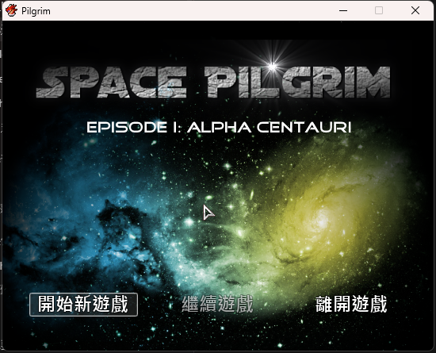

# Space Pilgrim Episode One Alpha Centauri 繁體中文化

[繁中翻譯工作表](Space%20Pilgrim%20Episode%20One%20-%20繁中翻譯工作表.xlsx)以 Steam 安裝版的原始資料為底稿。逐條在「繁體中文」欄填寫譯文，保留原文、編號、來源位置、換行與控制碼。

| 工作表 | 列數 | 內容 |
| --- | ---: | --- |
| 劇情事件 | 2,522 | 對話、選項、選項分支標籤及捲動文字 |
| 資料庫與系統 | 898 | 角色、道具、技能、選單與系統詞彙 |
| 圖像與外部文字 | 71 | 標題圖、可辨讀的招牌、結束畫面、製作名單與視窗標題 |
| 腳本待核對 | 3,524 | 腳本字串、任務日誌候選、事件註解與資料欄位 |

腳本工作表也保留內部識別資料供查對。像素圖細字、執行時組成的文字與 Steam 平台文字仍需逐畫面核對。

## 主選單測試

「開始新遊戲」、「繼續遊戲」、「離開遊戲」已透過 Steam 啟動確認顯示。翻譯工作表中對應的是原版系統詞彙 New Game、Load、Quit。

本專案以 `patch-title-menu.cjs` 重現主選單測試。執行前先關閉遊戲，將遊戲安裝資料夾作為第一個參數，並加上 `--apply`。工具會備份原始 `Game.rgss3a` 為 `Game.rgss3a.title-menu-test.bak`。需要還原時，關閉遊戲並以備份覆寫 `Game.rgss3a`。

## 重新匯出原文

`export-text.py` 接收遊戲資料夾與輸出 JSON 路徑，若存在主選單測試的備份，會優先讀取備份。接著在能載入 `@oai/artifact-tool` 的 Node.js 環境中，執行 `node build-workbook.mjs inventory.json output.xlsx`。重匯會生成原始翻譯底稿，請另外保留已填寫的工作表。
